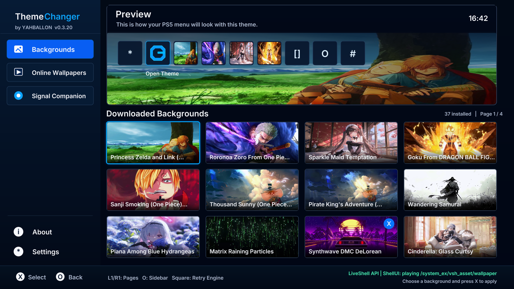

# ThemeChanger

PS5 wallpaper manager by **YAHBALLON**.

9660+ Live Wallpapers 4K

## Download

Get `PPSA99891.zip` from [Releases](https://github.com/Yahballon/ThemeChanger/releases/latest). Title ID: `PPSA99891`.

## Features

- Download and manage MotionBGS animated wallpapers.
- Integrated LiveShell engine, preview, About and Settings.
- Delete all downloaded wallpapers from Settings.
- Signal Companion controls and diagnostics.

## Compatibility

Signal's original firmware support is **9.00+**; upstream testing was on PS5 Pro 13.60. ThemeChanger now includes a firmware **5.10** LED path using single-step hold programs tested on a 5.10 console. Blue, amber and a purple mixture were visually confirmed, as were repeated colour changes. The integrated v0.3.22 app and continuous effects still require console validation.

### Console LED colours and effects

Open **Signal → Colour** to select a preset, adjust Blue / White / Amber, or keep a fixed colour. Firmware 5.10 is detected automatically by the bundled Signal payload; after updating, choose **Restart ps5-signal** once to replace an already running older service.

The new **Effects** tab offers Pulse, Blink, 4 Colours, Colour Wave and Breathe, with cycle durations from 0.5 to 20 seconds. Pulse, Blink and Breathe use the mix selected on the Colour tab. The four-colour palette is blue, white, amber and the console-tested purple mixture. Colour Wave blends those channels; it is not a full RGB rainbow, and independent red/green channels have not been established.

- **Apply effect** runs it in the background payload, including after ThemeChanger closes.
- **Save effect for payload startup** stores it for the next Signal start.
- Enable **Start with ps5-autoloader** to reload the payload after a reboot; saving alone does not install a boot service.
- **Stop and restore system colour** removes the saved effect and restores the LED program captured before custom control.

No LED firmware or NVS settings are flashed. A device error stops an effect instead of retrying continuously.

Some H.264 Level 5.0 videos still stall in the PS5 ShellUI decoder. Unmodified smooth Level 5.0 playback and automatic transcoding are **not fixed** in v0.3.21.

## Source and builds

The application, native tests, integration patches and release notes are in [homebrew/themechanger](homebrew/themechanger). GitHub Actions builds the PS5 installer and publishes `PPSA99891.zip` to Releases after successful checks. Push changes to `main`, or run **Build PS5 ThemeChanger** manually. Bump the app version, content version and workflow release tag for a new release.

Initial source snapshot: [tmp_lap commit 0ddf9f2](https://github.com/Yahballon/tmp_lap/commit/0ddf9f22428ecf0027299775af998ac2a7cc2659).

## Credits and license

GPL-3.0. Includes integrations with [ZiZc3/LiveShell](https://github.com/ZiZc3/LiveShell), [Marice/ps5-signal](https://github.com/Marice/ps5-signal), [Marice/ps5-signal-companion](https://github.com/Marice/ps5-signal-companion), and [blackbearreloaded/ps5-homebrew-ui](https://github.com/blackbearreloaded/ps5-homebrew-ui). See the integration documents for attribution and build details.
